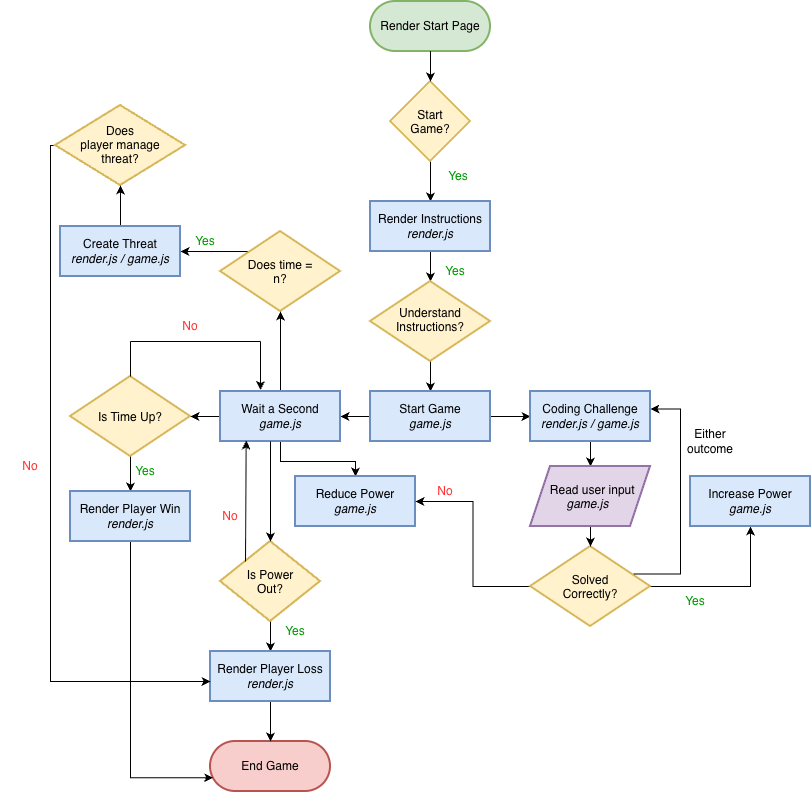

# 💻 Five Nights at the Hackathon

An interactive coding game partially inspired by Five Nights at Freddy's

## The Problem

Coding can become very overwhelming and, at many points, not fun. This project's aim is to allow users to study or improve their skills in a way that feels rewarding and entertaining, instead of draining. 

## How It Works

The software runs on a timer that dicates the occurence of certain events. The game's end condition depends on both the time and a light system which is influenced by the user's performance on the coding challenges.

## Tech Stack

- **Language:** HTML, CSS, JavaScript

## Setup

Step 1: Clone the repository
Step 2: Click the index.html file and play in browser or open in VS Code and use live server extension

Alternatively, once finished the site will be hosted on GitHub pages

## Usage

Simply hit "Start Game" and follow the instructions!

## Roadmap

- Add threats
- Add jumpscares or other game elements
- Vary the coding challenges for replayability
